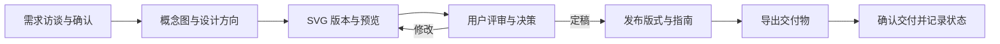

<p align="center">
  
</p>

<h1 align="center">印夏（YinXia）</h1>

<p align="center"><strong>面向设计者与 AI Agent 协作的本地 Logo 与品牌物料管理系统</strong></p>

<p align="center">
  <a href="#用途">用途</a> ·
  <a href="#安装">安装</a> ·
  <a href="#系统与设计仓库">系统与设计仓库</a> ·
  <a href="#使用流程">使用流程</a> ·
  <a href="#扩展工作流">扩展工作流</a> ·
  <a href="#检查与安全规则">检查与安全规则</a> ·
  <a href="#开发与维护">开发与维护</a> ·
  <a href="#常见问题">常见问题</a>
</p>

设计由你选用的 Agent 或设计工具完成，印夏负责把需求、概念图、设计方向、版本、评审和交付组织在一起。通过 SVG、Markdown、TOML 和 Git，你可以从最终交付物追溯到设计版本、参考图与关键决策。

本公开仓库只包含系统代码、模板、规则和测试，**不附带维护者的业务项目或本地测试项目**。安装后会创建默认设计仓库；也可接入多个独立仓库，分别存放自己的设计资料。

## 用途

印夏适合需要保留设计过程、反复迭代并输出多种品牌资产的工作：

- **管理设计过程**：记录需求简报、参考图、并行方向、版本说明和用户评审，保留每次取舍的依据。
- **检查 SVG**：核对色板、字体转曲、结构规范，并预览彩色、单色、反白和小尺寸效果。
- **生成交付物**：从定稿版式生成 SVG、Favicon、iOS/Android 图标和社交头像，附使用指南与文件校验清单。
- **管理品牌系列**：支持统一型、背书型、独立型架构，以及母子品牌评审和改版跟进。
- **制作封面物料**：复用已发布的 Logo，管理图片来源、多个画幅、平台裁切与上线记录。
- **接收外部设计**：先预演、核对冲突和来源，再将其他 Agent 或设计工具的作品纳入版本管理。

日常操作通过 `./logo` 命令完成。系统没有图形编辑界面；SVG 和文档由设计者或 Agent 编辑，预览结果以图片文件输出。CLI 本身不调用模型 API，使用的 AI 服务或图像生成工具由你另行选择。

## 安装

### 1. 准备环境

下方提供 **macOS + Homebrew** 的安装步骤。其他环境需要提供 Bash、Git、Python 3.11+、`resvg` 与 ImageMagick 的 `magick` 命令，并自行验证运行情况。

| 依赖 | 用途 |
|---|---|
| Git | 系统与项目版本管理、提交前检查 |
| Python 3.11+ | 运行 CLI；首次安装时须可通过 `python3` 调用 |
| resvg | SVG 渲染与位图导出 |
| ImageMagick（`magick`） | 预览拼图、图片处理与像素检查 |
| FontTools、uharfbuzz | 字体读取、排版和文字转曲，由 `setup` 安装 |

已安装 Homebrew 后执行。下例使用本地验证过的 Python 3.14，并将它的 `python3` 放到当前终端的 PATH 前部：

```bash
brew install git python@3.14 resvg imagemagick
export PATH="$(brew --prefix python@3.14)/libexec/bin:$PATH"
```

### 2. 克隆并初始化

```bash
git clone https://github.com/XiaTian-X/YinXia.git
cd YinXia
python3 --version
./logo setup
./logo --help
./logo status
```

`setup` 会：

1. 创建本地 `.venv` 并安装 [Python 依赖](tools/requirements.txt)。
2. 在 `projects/` 初始化独立 Git 仓库，生成忽略规则和项目看板。
3. 为系统与默认设计仓库启用各自的提交钩子。
4. 检查渲染工具与已登记字体的就绪情况。

首次运行需要联网安装 Python 依赖。以后执行命令会自动使用 `.venv`，无需先手工激活。渲染工具缺失时，`setup` 会提醒你安装；请处理这些提醒后再预览和导出。

### 3. 配置提交身份并保存初始项目仓库

两个仓库都需要可用的 Git 提交身份。若已有合适的全局配置，可以沿用；否则把下面的示例姓名和邮箱替换为自己的信息，分别配置本地身份：

```bash
git config --local user.name "Your Name"
git config --local user.email "you@example.com"
git -C projects config --local user.name "Your Name"
git -C projects config --local user.email "you@example.com"
```

在新初始化的项目仓库中保存看板与忽略规则：

```bash
./logo check
git -C projects add .gitignore PROJECTS.md
git -C projects commit -m "chore: initialize design workspace"
```

新项目仓库没有远程地址时会出现备份提醒，不影响本地使用。是否保留测试数据、何时为正式项目配置独立远程，由你决定。

### 4. 按需下载字体

```bash
./logo fonts
./logo fonts fetch inter
# 需要中文字体时再执行：
./logo fonts fetch source-han-sans-sc-bold
# 需要汉语拼音（带声调）时再执行：
./logo fonts fetch lxgw-pinyin-regular
# 需要中文楷体（霞鹜文楷）时再执行：
./logo fonts fetch lxgw-wenkai-medium
```

字体登记与授权原文位于 [assets/fonts](assets/fonts)。字体文件本身不进入 Git；`fetch` 从登记的官方地址下载，并核对 SHA-256。新增字体须先登记，非开源字体还须完成授权复核。详细流程见 [Logo 工作流](.agents/skills/logo-workflow/SKILL.md)。

## 系统与设计仓库

**一个系统仓库可以管理多个独立的设计 Git 仓库。** 每个设计仓库都有自己的提交历史、远程地址与访问权限；系统与设计改动分别提交。

| 仓库 | 内容 | 提交位置 |
|---|---|---|
| 系统仓库：根目录 | CLI、模板、平台规格、字体登记与授权、工作流、测试和钩子 | 根目录运行 `git …`，推送至本公开仓库 |
| 默认设计仓库：`projects/`，名称 `default` | 安装时初始化的多品牌工作区，兼容已有项目 | `git -C projects …` |
| 其他设计仓库：`repositories/<名称>/` 或系统目录外 | 单品牌仓库或多品牌工作区，可分别配置私有远程 | `git -C <仓库路径> …` |

系统仓库忽略 `projects/`、`repositories/` 和本机登记表 `.yinxia/`。推送系统改动不会上传设计数据；克隆本公开仓库也不会获得实际品牌项目或本机仓库清单。

### 两种组织方式可以并存

| 模式 | 适用范围 | 约束 |
|---|---|---|
| `single` | 一个独立品牌单独存放、授权和备份 | 最多一个品牌，不建立品牌系列 |
| `workspace` | 多个品牌集中管理，或同一品牌系列协作 | 可包含多个品牌与 `_series/`；同一系列的成员必须在同一工作区 |

两种模式都把品牌资料放在仓库内的 `<slug>/`（`inbox` 为收件箱保留名），由根目录的 `repository.toml` 记录模式。旧 `projects/` 没有此文件时按 `workspace` 处理，无需迁移历史。不同仓库可以使用相同品牌短名，因此操作目标由“仓库名 + 品牌短名”共同确定。

```bash
./logo repo list
./logo repo new studio --kind workspace
./logo repo new acme --kind single

# 只为本次命令选择仓库，不改变其他会话的默认选择
./logo --repo studio status

# 切换本机默认：后续省略 --repo 的命令使用 studio
./logo repo use studio
./logo status

# 查看所有已登记仓库的待办和检查结果
./logo status --all-repos
./logo check --all-repos
```

`repo new` 会初始化独立 Git 仓库、忽略规则、提交钩子、模式文件与看板，**不会自动创建品牌、提交或配置远程**。新建仓库后配置自己的 Git 身份，并保存初始文件；例如：

```bash
git -C repositories/studio config --local user.name "Your Name"
git -C repositories/studio config --local user.email "you@example.com"
./logo --repo studio check
git -C repositories/studio add .gitignore repository.toml PROJECTS.md
git -C repositories/studio commit -m "chore: initialize design workspace"
```

`single` 仓库也执行相同的初始化提交。完成需求访谈后，再通过 `./logo --repo acme new <slug> …` 创建其中的品牌。

接入已有的印夏设计仓库时，先克隆到系统目录外或 `repositories/<名称>/`，再登记。以下路径需替换为自己的实际路径：

```bash
./logo repo add client /absolute/path/to/design-repo
./logo --repo client index
./logo --repo client check

# 只取消本机登记，保留目录、设计文件与 Git 历史
./logo repo forget client
```

已有仓库须符合 `<slug>/project.toml` 等设计目录规范，不能直接登记任意代码仓库或扁平的单品牌目录。`repo add` 会同步忽略规则和提交钩子，必要时在该设计仓库单独提交这些维护改动。并发登记与切换通过本机文件锁顺序处理。登记表只保存在本机；换机器后需重新登记，并为各设计仓库分别配置提交身份和远程。

### 目录布局

```text
YinXia/                           # 系统仓库
├── .git/
├── logo                          # 统一命令入口
├── AGENTS.md                     # Agent 必须遵守的规则
├── .agents/skills/               # Logo、封面、导入工作流
├── .githooks/                    # 系统及设计仓库的提交钩子
├── tools/                        # Python 实现
├── templates/                    # 项目、版本、发布等模板
├── config/                       # Logo 目标与封面平台规格
├── assets/fonts/                 # 字体登记、授权；字体文件被忽略
├── tests/                        # 隔离的自动化测试
├── projects/                     # default：兼容保留的独立设计仓库
│   ├── .git/
│   ├── .gitignore
│   ├── PROJECTS.md               # 由 ./logo --repo default index 生成
│   ├── _series/                  # 按需创建：系列规则与家族封面
│   └── <slug>/
│       ├── project.toml          # 元数据、状态、色板、字体、导出配置
│       ├── brief.md              # 需求简报与确认记录
│       ├── concepts/             # 概念图及来源记录
│       ├── directions/           # 各方向及 vNNN/{logo.svg, notes.md}
│       ├── decisions/            # 关键取舍记录
│       ├── releases/             # 定稿版式、发布说明、使用指南
│       ├── covers/               # 按需创建：封面稿及已登记素材
│       ├── latest/               # 按需创建：当前发布的固定地址副本（./logo latest，需提交）
│       └── dist/                 # 按需生成的交付物，不提交
├── repositories/                 # 按需创建，整个目录被系统 Git 忽略
│   ├── studio/                   # workspace：独立 .git、repository.toml、PROJECTS.md
│   │   ├── <slug>/               # 与默认仓库相同的品牌目录结构
│   │   ├── _series/              # 本工作区内的系列
│   │   └── inbox/                # 本仓库收件箱，不提交
│   └── acme/                     # single：独立 Git，最多一个 <slug>/
├── .yinxia/                      # 本机登记表与默认选择，不提交
├── inbox/                        # default 专用收件箱，不提交
├── .cache/                       # 按仓库隔离的预览、预演与临时文件，不提交
└── .venv/                        # 共享的本地 Python 环境，不提交
```

系统代码、模板、平台规格与字体登记由所有仓库共享；品牌需求、系列、版本、封面、看板和交付物在各设计仓库内独立保存。默认仓库沿用根目录 `inbox/`；其他仓库使用各自根目录的 `inbox/`。预演记录按仓库与路径隔离，不能用一个仓库的预演记录直接导入另一个仓库。色板、发布、系列或封面规格变化后，需要重新预演并确认。

`project.toml` 的 `[state]` 由 CLI 维护，`PROJECTS.md` 是自动生成的视图。色板、配色模式、字体和导出配置可按需求维护；创建项目、方向、版本、发布和决策记录时，统一使用 `./logo`。

## 使用流程



### 与 Agent 协作

让能读取本地文件、编辑 SVG 并运行命令的 Agent 先阅读 [AGENTS.md](AGENTS.md)，再按对应工作流操作。可以从下面的请求开始：

> 请阅读 AGENTS.md 和 .agents/skills/logo-workflow/SKILL.md，先运行 ./logo repo list 和 ./logo status --all-repos 告诉我现有仓库与待办，确认目标仓库。我想为一个品牌设计 Logo，请先完成需求访谈，确认项目类型、品牌信息、视觉偏好和使用场景，再开始设计。

每次新会话先看 `./logo repo list` 和 `./logo status --all-repos`，确认目标仓库；后续可用 `./logo --repo <名称> status` 查看该仓库。预览或对比图生成后，需要打开并交给用户审阅，再把结论记录进项目。

### 1. 确认需求并建立项目

以下以虚构项目 `demo` 演示独立 Logo 流程。**按阶段执行；中间的文档填写、设计和用户评审完成后，再执行下一阶段。**

下面在默认仓库演示；使用其他仓库时，将每条 `./logo` 命令加上 `--repo <名称>`，并将 `projects/` 和 `git -C projects` 替换为对应仓库路径。多人或多个 Agent 并行操作时，应始终显式指定 `--repo`。

确认需求后选择默认仓库并创建项目：

```bash
./logo repo use default
./logo new demo --name "示例品牌" --targets svg,favicon,ios,android,avatar
```

填写 `projects/demo/brief.md`，包括品牌理念、文字内容、视觉偏好、使用场景、字体策略和需求确认；再维护 `project.toml` 的色板与导出配置。简报缺少必需章节、字段或仍有占位时，系统会拒绝新建设计方向。

有参考图时先用 `./logo concept` 登记来源；后续版本可通过 `--inspired-by` 引用。品牌系列项目还需要先建立系列并填写系列规则，详见下方扩展工作流。

### 2. 建立方向并迭代 SVG

```bash
./logo direction demo A geometric --title "几何方向"
./logo version demo A
```

完成以下文件：

- `directions/A-geometric/direction.md`：方向理念与视觉基调。
- `directions/A-geometric/v001/logo.svg`：实际设计，使用项目色板中的颜色。
- `directions/A-geometric/v001/notes.md`：改动说明、理念体现与评审记录。

上述路径均位于 `projects/demo/`。文字须使用已登记字体，通过 `./logo outline --project demo …` 转曲。

```bash
./logo preview demo A-v001
# 有多个候选版本时，可生成对比图：
./logo compare demo
```

审阅预览并填完文档后保存迭代：

```bash
./logo index
./logo check
git -C projects add -A
git -C projects commit -m "[demo] A-v001: geometric direction"
```

**提交后，该版本的 SVG 冻结。** 下一次修改用 `./logo version demo A` 创建 `A-v002`，评审文字在原记录末尾追加。

### 3. 记录定稿决策并发布

用户确认方案后：

```bash
./logo decision demo finalize-a-v001 --title "确认 A-v001 定稿"
./logo state demo selected_version=A-v001
```

填写新建决策文档，记录选项、取舍和用户结论，再创建发布：

```bash
./logo release demo --from A-v001
```

首次发布生成 `projects/demo/releases/r1/`。发布前须完成：

- `layouts/primary.svg`：必需主版，由选定版本起稿。按需增加 `icon.svg`、`horizontal.svg`、`wordmark-cn.svg`、`wordmark-en.svg`、`wordmark-pinyin.svg`；App 图标与头像可用 `app-icon.svg`、`avatar.svg` 手工覆盖，单色、反白可用 `<版式>.mono.svg`、`<版式>.reversed.svg` 覆盖。
- `release.md`：填写发布说明，并引用真实的 `decisions/NNN-*.md`；编号以命令输出为准。
- `guide.md`：填完标志结构、最小尺寸、安全留白与错误用法，它会随交付物一起导出。
- 可选 `./logo latest demo`：把当前发布的标志版式（彩色、单色、反白）写入 `projects/demo/latest/demo-<版式>[-<配色>]-latest.svg`，README 等外部引用这个固定地址即可随发布更新。latest/ 一旦存在，之后每次发布都要重新生成并一起提交，检查会核对它与当前发布一致。

```bash
./logo preview demo r1
```

用户审阅通过后：

```bash
./logo index
./logo check
git -C projects add -A
git -C projects commit -m "[demo] release r1"
```

### 4. 导出并交付

```bash
./logo export demo
# 也可只重新生成指定目标：
./logo export demo ios avatar
```

交付物位于 `projects/demo/dist/r1/`，包含目标文件、`guide.md` 和 `manifest.json`，不提交 Git。

| 导出目标 | 主要产物 |
|---|---|
| `svg` | 发布中的标志版式及彩色、单色、反白配色 |
| `favicon` | 多尺寸 PNG、ICO、Apple 触控图标 |
| `ios` | 不透明 App 图标 |
| `android` | 多密度图标、Play 图标、自适应背景/前景/单色层 |
| `avatar` | 多尺寸社交头像，图形留在圆形安全区内，适配圆形裁切 |

图标优先采用 `icon.svg`，缺省时使用 `primary.svg`；App 图标和头像按项目底色与配色配置自动排版，也支持手工覆盖。具体尺寸与规则见 [Logo 导出配置](config/logo-targets.toml)。

`manifest.json` 记录仓库名称、发布来源、设计版本、每个目标对应的系统提交、项目提交、渲染器版本及文件 SHA-256。部分导出时，未重新生成且校验一致的目标保留原来源；文件若被改动，来源字段标为空，避免误认成原始导出。复现导出时应保持这些版本与配置一致。

实际完成交付后，再记录状态：

```bash
./logo state demo stage=delivered
./logo index
./logo check
git -C projects add -A
git -C projects commit -m "[demo] mark r1 delivered"
```

## 扩展工作流

| 场景 | 入口与说明 |
|---|---|
| 品牌系列 | `./logo series`；统一型、背书型子品牌需要母品牌先发布，定稿前须通过系列评审；改版后记录跟进决定。详见 [Logo 工作流](.agents/skills/logo-workflow/SKILL.md) |
| 外部 Logo | `./logo inbox`、`./logo import … --analyze`；先展示预演，再逐项决定颜色冲突、来源和使用条款。详见 [导入工作流](.agents/skills/import-workflow/SKILL.md) |
| 外部 Agent 交接 | `./logo handoff brief`、`receive`、`validate`、`feedback`；外发说明书前确认用户同意。交接标记为 `YinXia`，生成的通用 skill 标识为 `yinxia-handoff` |
| 封面与家族封面 | `./logo cover platforms` 查看 [平台规格](config/cover-platforms.toml)；先立项与登记素材，再设计、预览、导出。Logo 只能引用发布版并移动缩放。详见 [封面工作流](.agents/skills/cover-workflow/SKILL.md) |
| 母品牌与封面同步 | `./logo series sync` 记录子品牌跟进；`./logo cover sync-logo` 更新封面中的 Logo，之后重新预览 |
| 单张渲染 | `./logo render demo primary --mode mono --size 800`，输出到 `dist/render/` |

查看完整参数：

```bash
./logo --help
./logo import --help
./logo series --help
./logo cover --help
./logo handoff --help
```

## 检查与安全规则

规则总览见 [AGENTS.md](AGENTS.md)。系统与各设计仓库的提交钩子都会运行对应的 `check`；任何错误都需要先修复，再提交。

| 对象 | 规则 |
|---|---|
| 版本 SVG、发布版式、概念图、已登记封面素材 | 提交后不可修改或删除；通过新版本、新发布或新素材继续迭代 |
| 方向、版本说明、决策、概念记录、发布说明、指南、系列规则等过程文档 | 提交后只允许在末尾追加，保留原有字节、换行格式和末尾空行 |
| SVG | 使用 `viewBox`；文字转曲；颜色来自色板；禁止脚本、事件、外链与 Logo 内嵌位图 |
| 新建文档 | 提交前填完模板占位；发布说明引用决策，参考图须登记 |
| 提交内容 | 系统与各设计仓库均采用目录白名单；设计资料禁止符号链接和嵌套 Git 仓库；缓存、依赖、临时文件、生成物、字体文件和凭据受忽略与钩子检查保护 |
| 敏感内容 | 扫描已知密钥特征和敏感字段中的长字符串，覆盖大文件及二进制中的明文；诊断不回显匹配内容 |

提交时以暂存区中的设计配置和项目看板为准，检查 SVG、不可变文件及敏感内容；几何与目录一致性检查仍需工作区文件，暂存区中的 SVG 或配置文件若在工作区缺失，须先恢复再提交。设计仓库钩子根据实际提交目录选择检查对象，不受 `repo use` 切换或其他仓库 Git 环境变量影响；部分提交仍检查该次提交自己的暂存区。系统钩子固定检查系统，默认设计仓库的问题作为提醒。要检查全部设计仓库，运行 `./logo check --all-repos`。

手动运行 `./logo check` 还会查看当前发布是否可交付、历史不可变性、钩子状态和备份情况。它也会提醒单色细节丢失、图标安全区、封面过时或平台规格需复核等问题；视觉与授权判断仍需要用户参与。

预览、临时脚本放 `.cache/`；外部原件进入所选仓库的收件箱；导出结果放对应品牌的 `dist/`。这些目录均不进入版本控制。字体只提交登记和授权文件，密钥应存放在仓库之外或环境变量中。

## 开发与维护

修改系统代码、模板、配置或钩子后，提交前运行：

```bash
./logo selftest
./logo check --all-repos
```

测试会在临时目录中搭建隔离的系统仓库与项目仓库，覆盖实际命令、多仓库选择与隔离、两种仓库模式、Git 钩子、导出、系列、封面、导入和安全规则。默认最多使用 8 个进程；测试缺少渲染工具或字体时，相关用例会跳过，需留意输出。

```bash
./logo selftest test_unit
./logo selftest -j 1
```

系统改动在根目录提交，设计改动在各自仓库提交，各仓库分别检查、分别保存历史。更新系统后，对每个已登记仓库运行 `./logo --repo <名称> setup` 同步忽略规则与钩子；若更新了 `.gitignore`，在对应设计仓库单独提交该变化。系统目录搬迁后，重新登记失效的外部路径并为各仓库执行 `setup`。

## 常见问题

**为什么 GitHub 上没有项目看板或示例品牌？** 公开仓库只分发系统；看板和实际项目在本地独立项目仓库中生成，示例中的 `demo` 只是流程演示。

**旧 `projects/` 需要拆分或迁移吗？** 不需要，它继续作为 `default` 多品牌工作区运行。新仓库可与它并存；`repo add` 只登记符合结构的独立仓库，不拆分已有历史。

**切换仓库后操作不明确怎么办？** 先运行 `./logo repo list` 核对路径，再显式使用 `./logo --repo <名称> …`。可通过 `./logo repo use default` 恢复默认；`--repo` 只影响当前命令。

**`direction` 提示需求未完成怎么办？** 补齐简报必需章节、字段和用户确认；系列成员还须填完系列规则。删掉占位所在的整段不能代替填写。

**已提交文件需要修改怎么办？** SVG 用新版本或新发布；只追加文档在末尾补充记录。指南事实错误可追加明确勘误并重新导出；已提交指南仍留有模板占位时，需通过 `release --from rN` 新建发布并填完。

**为什么新安装后有字体或备份提醒？** 字体按需下载；项目仓库默认只在本地初始化，远程地址由你自行配置。正式设计资料建议单独备份，系统仓库的远程不会备份项目数据。

**在哪里查找操作细节？** 命令参数看 `./logo <命令> --help`；完整设计流程看 [Logo 工作流](.agents/skills/logo-workflow/SKILL.md)，外部设计与品牌物料分别看 [导入工作流](.agents/skills/import-workflow/SKILL.md) 和 [封面工作流](.agents/skills/cover-workflow/SKILL.md)。
